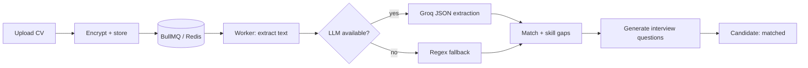

# Recrutini

AI-powered recruitment platform. Upload CVs, extract structured candidate data, score fit against job requirements, spot skill gaps, and generate technical interview questions.

> Built solo with NestJS, React and PostgreSQL. [TODO: live demo link or "demo GIF below"]

 <!-- TODO: add screenshots -->

## What it does

- **CV ingestion**: PDF upload, encrypted at rest (AES-256-GCM)
- **Extraction**: Groq LLM (`llama-3.3-70b-versatile`) turns raw CV text into structured JSON. [TODO: confirm JSON mode]
- **Fallbacks**: deterministic regex parsing when the LLM is unavailable or no API key is set. [TODO: OCR (Tesseract) for scanned PDFs, only keep if it's really in the code]
- **Matching**: weighted skill scoring of a candidate against a job's required skills. [TODO: explain the weights in one line]
- **Skill gaps**: lists what the candidate is missing for the job
- **Interview questions**: LLM-generated technical questions tailored to the gaps
- **Access control**: JWT auth, roles: [TODO: Admin / HR / Tech Lead, what each can do]. Public registration is disabled; the admin creates accounts.

## How it works

Uploads are never processed in the request. The API stores the file, queues a job, and a worker does the heavy lifting.



Candidate status flow: `uploaded → processing → matched` (or `failed`).

[TODO: if there's real agent/tool-calling, add a section here describing the loop and the tools. If it's a fixed sequence, leave it out.]

## Tech stack

| Layer | Tech |
|---|---|
| Backend | NestJS, TypeORM, PostgreSQL |
| Queue | BullMQ, Redis |
| AI | Groq API (configurable model) |
| Frontend | React, Vite |
| Infra | Docker, Docker Compose |
| Docs | Swagger at `/api/docs` |

## Quickstart (Docker)

```bash
cp .env.example .env     # set secrets
docker compose up --build
```

| Service | URL |
|---|---|
| Frontend | http://localhost:5173 |
| API | http://localhost:3000 |
| Swagger | http://localhost:3000/api/docs |

Create the first admin:

```bash
cd apps/backend
npm install
INIT_ADMIN_EMAIL=admin@example.com INIT_ADMIN_PASSWORD=change_me \
  node -r ts-node/register scripts/seed-admin.ts
```

Then sign in at `/login` and create departments, users and jobs from the Admin UI.

## Environment variables

| Variable | Purpose |
|---|---|
| `PORT`, `CORS_ORIGIN` | API port and allowed frontend origin |
| `DB_HOST`, `DB_PORT`, `DB_USER`, `DB_PASSWORD`, `DB_NAME` | PostgreSQL |
| `REDIS_HOST`, `REDIS_PORT` | Redis for BullMQ |
| `JWT_SECRET` | JWT signing |
| `CV_ENCRYPTION_KEY` | AES-256-GCM key for uploaded CVs |
| `GROQ_API_KEY` | Optional. Without it, extraction falls back to local logic |
| `GROQ_MODEL` | Defaults to `llama-3.3-70b-versatile` |

## Local development

```bash
# backend
cd apps/backend && npm install && npm run start:dev

# frontend
cd apps/frontend && npm install && npm run dev
```

Needs PostgreSQL and Redis running (Docker is easiest).

## Project structure

```
apps/
  backend/
    src/ai/           LLM integration + fallbacks
    src/queue/        BullMQ setup
    src/candidates/   processors, matching logic
    scripts/          seed-admin.ts
  frontend/           React + Vite UI
```

## Smoke test

1. Seed the admin and sign in
2. Create a job with required skills
3. Upload a CV on the job's candidates screen
4. Watch the status go `uploaded → processing → matched`
5. Check parsed data, match score, skill gaps and generated questions

## Design decisions

- **Queue over inline processing**: LLM and OCR calls are slow and can fail, so they run in workers with retries.
- **Graceful degradation**: no API key or LLM failure never blocks the pipeline.
- **Encrypted at rest**: CVs hold personal data, so files are encrypted and only decrypted for processing or download.


## Author

Baha Eddine Jdidi, [portfolio](https://bahajdidi.vercel.app) · [GitHub](https://github.com/YngJesus) · [LinkedIn](https://linkedin.com/in/bahaeddinejdidi)

## License
    MIT
